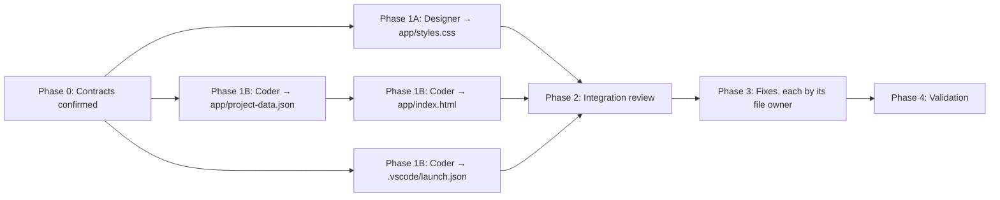

# Project Pulse Dashboard: Implementation Plan

## Summary

Mona's team needs **Project Pulse**, a small static dashboard. It lets contributors see at a glance which projects are active, who owns each one, its current status, recent activity, and priority or risk. Each project also gets a short contributor-friendly summary. The layout is card-based, with status badges and readable spacing.

The deliverable is three static app files plus one VS Code launch configuration:

| File | Purpose |
| --- | --- |
| `app/index.html` | Page shell, semantic markup, and an inline script that loads and renders project cards |
| `app/styles.css` | All visual design: layout, cards, badges, responsive behavior, focus states |
| `app/project-data.json` | Project data under a top-level `projects` array |
| `.vscode/launch.json` | The **Run Project Pulse Dashboard** launch configuration, which serves `app/` and opens `index.html` |

Repository facts this plan relies on:

- `app/` exists and is empty. `.vscode/` already contains `tasks.json`, which must not be changed.
- The source of truth is [.github/project-pulse-brief.md](.github/project-pulse-brief.md). Exact requirements come from [.github/steps/3-step.md](.github/steps/3-step.md) and [.github/workflows/3-step.yml](.github/workflows/3-step.yml).
- Agent rules come from [.github/agents/designer.agent.md](.github/agents/designer.agent.md) and [.github/agents/coder.agent.md](.github/agents/coder.agent.md). Each agent stays within its assigned files. The Coder writes `launch.json` as strict JSON with `cwd` set to `${workspaceFolder}/app`. No agent stages, commits, or pushes.
- The devcontainer installs only the Copilot and GitHub Actions extensions. The Python extension is **not** guaranteed to be installed, so the launch configuration must not depend on it.

---

## Shared contracts (agreed before any file is written)

Both agents build against these contracts. That is what lets the Designer and Coder work in parallel without touching the same file.

### Data contract: `app/project-data.json`

- Top-level object with a `projects` array of 4–6 projects.
- Required fields on every project, as strings: `name`, `owner`, `status`, `recentActivity`, `priority`.
- Optional field: `summary`, a one-sentence description for contributors.
- Allowed `status` values: `Active`, `At Risk`, `Blocked`, `Completed`.
- Allowed `priority` values: `High`, `Medium`, `Low`.
- The sample data should use every status and every priority at least once so all badge styles can be checked visually.

```json
{
  "projects": [
    {
      "name": "Docs Refresh",
      "owner": "Mona",
      "status": "Active",
      "recentActivity": "Merged navigation cleanup 2 days ago",
      "priority": "High",
      "summary": "Rewriting contributor guides for first-time contributors."
    }
  ]
}
```

### Markup and CSS class contract

The Coder renders this structure in `app/index.html`. The Designer styles exactly these hooks in `app/styles.css`.

| Hook | Element / usage |
| --- | --- |
| `.dashboard` | `<main>` wrapper for the whole dashboard |
| `.dashboard-header` | Header containing the `<h1>` "Project Pulse" and a short intro/summary line |
| `.dashboard-summary` | Optional status counts (e.g. "3 active · 1 at risk") |
| `.project-grid` | Container for the cards; it is a responsive grid |
| `.project-card` | One `<article>` per project |
| `.project-card__name` | Project name heading (`<h2>`) |
| `.project-card__owner` | Owner line |
| `.project-card__summary` | Optional summary text |
| `.project-card__activity` | Recent activity line |
| `.status-badge` + `.status-badge--active`, `--at-risk`, `--blocked`, `--completed` | Status badge and its color modifiers |
| `.priority-badge` + `.priority-badge--high`, `--medium`, `--low` | Priority badge and its color modifiers |
| `.badge--unknown` | Fallback style for values not in the allowed lists |
| `.dashboard-message` | Loading, empty, and error message area (`role="status"` / `aria-live="polite"`) |

**Modifier rule:** take the field value, lowercase it, and replace spaces with hyphens. For example, `At Risk` becomes `--at-risk`.

---

## Responsibilities

### Designer

- **Owns:** `app/styles.css`. This is the only file the Designer edits.
- Creates a polished dashboard, not a plain page:
  - Includes the `.dashboard` and `.project-card` selectors.
  - Uses `border-radius` and `box-shadow` on cards.
  - Uses a responsive grid: 1 column on mobile, 2–3 columns on wider screens.
  - Uses readable spacing and a clear type scale.
- Defines badge colors with WCAG AA contrast (4.5:1 for text). Badges carry their text label, so meaning never depends on color alone.
- Sets visible `:focus-visible` styles. Supports `prefers-reduced-motion` if any transitions are used.
- Establishes the visual hierarchy: title, then summary counts, then cards. Within each card: name, status and priority badges, owner, summary, recent activity.
- **Review only:** `app/index.html`. The Designer reviews it for semantics and accessibility (heading order, landmarks, `lang`, viewport meta) and sends any requested changes to the Coder through the Orchestrator. The Designer does not edit it directly.

### Coder

- **Owns:** `app/project-data.json`, `app/index.html`, and `.vscode/launch.json`.

**`app/project-data.json`**

- Valid JSON that follows the data contract.

**`app/index.html`**

- Starts with `<!DOCTYPE html>`, uses `lang="en"`, and includes the viewport meta tag.
- `<title>` and `<h1>` both contain the exact text **Project Pulse**.
- Links `styles.css` with a relative path.
- An inline `<script>` uses `fetch("project-data.json")` (relative path) and renders one `.project-card` per project.
- Shows `status`, `recentActivity`, and `priority`. The literal field names must appear in the script, because the workflow searches for them as keyphrases.
- Builds the DOM with `textContent` and `createElement`, **not** `innerHTML` with data values. This prevents injected markup (XSS hygiene).
- Shows a loading message, an empty-state message (no projects), and an error message (fetch or parse failure, or the page opened via `file://`) in `.dashboard-message`.
- Keeps all JavaScript inline. The brief limits the app to three files, so there is no `app.js`.

**`.vscode/launch.json`**

| Field | Value |
| --- | --- |
| `version` | `"0.2.0"` |
| `name` | `"Run Project Pulse Dashboard"` |
| `type` | `"node-terminal"` (built into VS Code, so the Python extension is not needed) |
| `request` | `"launch"` |
| `command` | `"python3 -m http.server 5500"` |
| `cwd` | `"${workspaceFolder}/app"` |
| `serverReadyAction.pattern` | Regex that matches the http.server startup line and captures the port, e.g. `Serving HTTP on .* port ([0-9]+)` |
| `serverReadyAction.uriFormat` | `"http://localhost:%s/index.html"` |
| `serverReadyAction.action` | `"openExternally"` |

- Write it as strict JSON: no comments and no trailing commas.
- Do **not** modify the existing `.vscode/tasks.json`.

### Orchestrator

- Hands each agent its explicit file scope from this plan.
- Runs the phases below, integrates the results, and runs validation.
- Is the only path for cross-agent change requests.

---

## Implementation phases and dependencies



| Phase | Work | Owner | Depends on |
| --- | --- | --- | --- |
| 0 | Confirm the data contract and class contract (this document) | Orchestrator | — |
| 1A | Build `app/styles.css` | Designer | Phase 0 |
| 1B-1 | Create `app/project-data.json` | Coder | Phase 0 |
| 1B-2 | Create `app/index.html` | Coder | Phase 0, 1B-1 (field names and values must match) |
| 1B-3 | Create `.vscode/launch.json` | Coder | Phase 0 only. It needs `app/index.html` to exist only when it runs, not when it is written. |
| 2 | Integration review: run the dashboard; Designer reviews the rendered UI and `index.html` semantics | Orchestrator + Designer | 1A, 1B-2, 1B-3 |
| 3 | Apply fixes: CSS changes by the Designer, markup/data/launch changes by the Coder | Designer / Coder | Phase 2 |
| 4 | Final validation (see below) | Orchestrator, with the Coder running checks | Phase 3 |

### Key dependencies

- `app/index.html` depends on `app/project-data.json`: field names, the top-level `projects` key, and the allowed status and priority values.
- `app/styles.css` depends on the class contract, **not** on the finished `index.html`. That is why it can be built in parallel.
- `.vscode/launch.json` depends on the `app/` directory and the `index.html` filename. When it runs, it also depends on the HTML, CSS, and JSON files being present.
- Validation depends on all four files.

---

## Parallel work decisions

### Can run in parallel

- **Phase 1A (Designer: `app/styles.css`) runs alongside Phase 1B (Coder: `app/project-data.json`, `app/index.html`, `.vscode/launch.json`).** Their file scopes do not overlap, and the shared class contract removes the data dependency between them.
- `.vscode/launch.json` is independent of the other Coder files. Because one Coder handles all three, they are written one after another inside Phase 1B. If the Orchestrator splits the work across two Coder runs, `launch.json` can go to one and the data/HTML pair to the other.

### Must be sequential

- `app/project-data.json` comes **before** `app/index.html`, because the renderer must match the real field names and values.
- Integration review (Phase 2) comes only after all four files exist.
- Fixes (Phase 3) come after review. If a fix touches both CSS and markup, the Coder changes the markup first, then the Designer updates the CSS. These are **never** done at the same time.
- Final validation (Phase 4) comes last.

### Avoiding file ownership collisions

- Each file has exactly **one** owner for the whole build:

  | File | Owner |
  | --- | --- |
  | `app/styles.css` | Designer |
  | `app/index.html` | Coder |
  | `app/project-data.json` | Coder |
  | `.vscode/launch.json` | Coder |

- The Designer must not add inline `<style>` blocks or `style=""` attributes through the Coder. All visual rules stay in `app/styles.css`.
- The Coder must not add or edit CSS rules.
- New class names may be needed during review. The Orchestrator adds them to the class contract first, then assigns the markup change (Coder) and the styling change (Designer) in sequence.
- No agent touches `.vscode/tasks.json`, `.devcontainer/`, `.github/`, or `docs/agent-team.md`.

---

## Edge cases to handle

| Case | Expected handling |
| --- | --- |
| Page opened via `file://` instead of the server | `fetch` fails; show a clear error in `.dashboard-message` ("Run the 'Run Project Pulse Dashboard' launch configuration") |
| `project-data.json` missing or malformed | Catch the error and show an error message instead of a blank page |
| `projects` is empty or not an array | Show an empty-state message |
| Project missing a field | Render a placeholder such as "Not provided"; the card still renders |
| Status or priority not in the allowed list | Show the raw text with the `.badge--unknown` neutral style |
| Long names or activity text | CSS wraps the text (`overflow-wrap: anywhere`) so cards never overflow |
| Port 5500 already in use | The server fails to start. Document this: stop the earlier preview first. Do not change the port, because the step instructions require 5500. |
| Server opens a directory listing | Prevented by `cwd` = `app/` plus a `uriFormat` that ends in `/index.html` |
| Codespaces port forwarding | `localhost` URLs are forwarded automatically; `openExternally` opens the forwarded URL |
| Python output buffering stops `serverReadyAction` from firing | `node-terminal` runs in a TTY, so output is line-buffered. If the browser does not open, adding `"env": { "PYTHONUNBUFFERED": "1" }` is an allowed fix. |

---

## Validation expectations

### Automated checks (match `.github/workflows/3-step.yml`)

1. `python3 -m json.tool app/project-data.json` exits 0.
2. `python3 -m json.tool .vscode/launch.json` exits 0, which proves there are no comments or trailing commas.
3. Every project object contains `name`, `owner`, `status`, `recentActivity`, and `priority`. Check this with a short `python3` one-liner over `projects`.
4. `app/index.html` contains: `Project Pulse`, `styles.css`, `project-data.json`, `project-card`, `status`, `recentActivity`, `priority`.
5. `app/styles.css` contains: `.dashboard`, `.project-card`, `border-radius`, `box-shadow`.
6. `.vscode/launch.json` contains: `Run Project Pulse Dashboard`, `index.html`, `${workspaceFolder}/app`, `python3 -m http.server 5500`, `serverReadyAction`, `http://localhost:%s/index.html`.

### Server smoke test

1. From `app/`, start `python3 -m http.server 5500` in the background.
2. `curl -s http://localhost:5500/index.html` returns HTML containing "Project Pulse". It must not contain "Directory listing for".
3. `curl` for `styles.css` and `project-data.json` both return HTTP 200.
4. Stop the server afterwards.

### Manual launch check

1. Open **Run and Debug**, select **Run Project Pulse Dashboard**, and press play.
2. The browser opens `…/index.html`, not a directory listing.
3. The page shows the "Project Pulse" title and one styled `.project-card` per project.
4. Each card shows status and priority badges, owner, and recent activity.
5. Stop the preview server when done.

### Design and accessibility check (Designer review)

- Exactly one `<h1>`, then one `<h2>` per card. The `<main>` landmark is present.
- Badge text contrast meets WCAG AA. Status and priority are readable without color.
- Keyboard focus is visible.
- The layout reflows to one column at about 375px width with no horizontal scrolling.

### Note on `scripts/validate-exercise.sh`

This script checks the template, not learner work. It reports a failure when learner files such as `app/*` are tracked. Do **not** use it as the acceptance gate for this build.

### Git

No agent stages, commits, or pushes. The learner runs all git operations through Copilot CLI prompts.

---

## Assumptions and open questions

1. **"Short contributor-friendly summary":** This plan reads it as an optional per-project `summary` field **plus** a dashboard-level status count line. If Mona meant only one of these, drop the other.
2. **`recentActivity` format:** This plan assumes a human-readable string (e.g. "Merged PR 2 days ago"). An object with ISO dates would allow sorting but adds complexity. It is not needed for the brief.
3. **Status and priority vocabulary:** The allowed values (`Active` / `At Risk` / `Blocked` / `Completed`, `High` / `Medium` / `Low`) are proposed, not given in the brief. Confirm them before Phase 1.
4. **Launch `type`:** `node-terminal` is chosen because it does not need the Python extension. If the learner's environment has issues with `node-terminal`, the fallback is `debugpy` with `module: http.server`, but that requires installing the Python extension.
5. **Inline script:** All JavaScript stays inside `app/index.html` to keep to the brief's three-file limit. A separate `app.js` would need the brief to be updated.
6. **Sorting and filtering:** Out of scope. Cards render in data order. A future enhancement could sort by priority.
